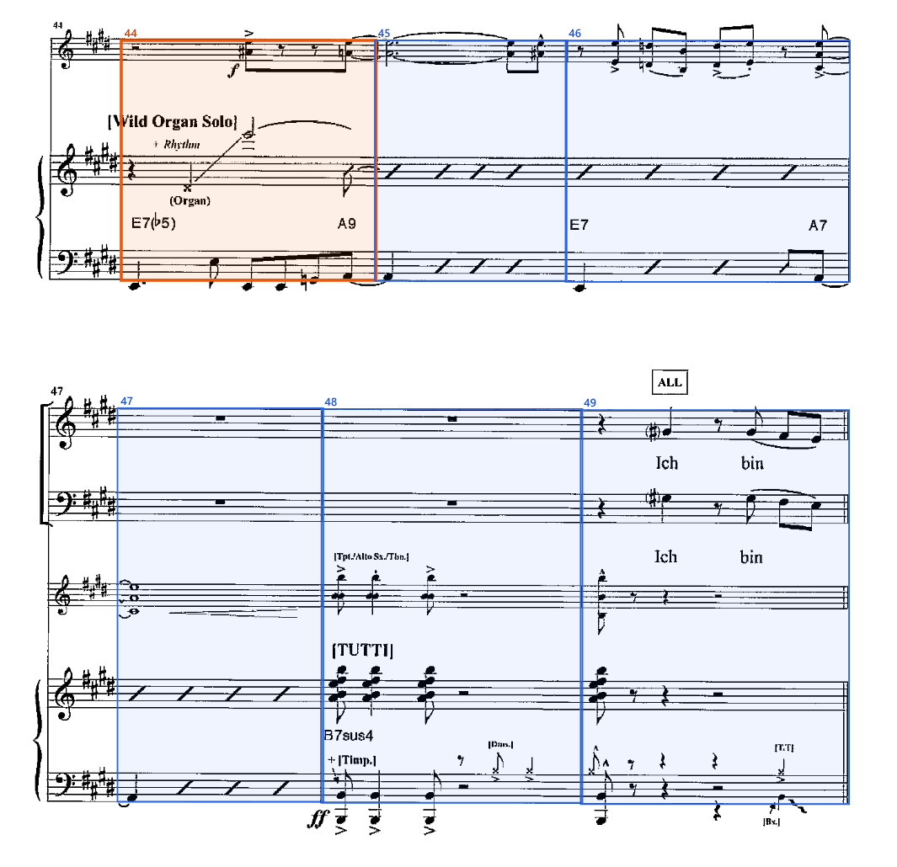

# measure-detection



Finds every measure on printed and scanned sheet-music pages (piano-conductor, piano-vocal and vocal scores) and reads its measure label (`12`, `23A`, `B`). The result is a list of measures with page, quadrilateral, axis-aligned box, label and confidence, in the same JSON schema as the training annotations.

The repository contains:

- the training and evaluation pipeline (Python, `src/mdet/`),
- the browser runtime as an npm package (`packages/measure-detection/`), which reproduces the Python pipeline with ONNX models.

Design, terms and decisions: [`docs/PLAN.md`](docs/PLAN.md). Annotation conventions found in the data: [`docs/CONVENTIONS.md`](docs/CONVENTIONS.md). Measured results: [`docs/RESULTS.md`](docs/RESULTS.md).

## How it works

Most of the work is classical image processing. Two small networks make the decisions that rules cannot make reliably.

| Stage | Method |
|---|---|
| 0 Render | pdf.js, two passes (staff space first, then a resolution with s close to 18 px) |
| 1 Normalize | Staff space s from vertical run lengths; deskew by projection energy; page scaled to s = 16 and s = 8 |
| Systems | Staff lines from slab projections; five equidistant lines form a staff; staves joined by the system's opening line form a system |
| 2 Rectify | Each system becomes a straight strip (staff contours fitted per staff, per-system scan shear corrected), 6 s margins |
| 3 Boundaries | **MeasureNet** (0.27 M parameters): per-column probabilities of start boundary and barline; peak picking |
| Text | Connected components in the strip margins, grouped into candidate strings |
| Labels | **LabelOCR** (0.77 M parameters, convolutional CTC): reads candidates, top-5 hypotheses |
| 4 Assign | Hungarian assignment of readings to measures by offset likelihood; the document's number placement is estimated on the fly |
| 5 Decode | Viterbi over the whole document: consecutive numbering is the prior, readings are evidence; multi-measure rests (`12-15`) are split |

## Using the npm package

```js
import * as pdfjs from "pdfjs-dist";
import { MeasureDetector } from "measure-detection";

const detector = await MeasureDetector.create({
  models: { measurenet: "/models/measurenet.onnx", labelocr: "/models/labelocr.onnx" },
  decoder: await (await fetch("/models/decoder.json")).json(),
});
// wasmUrl lets pdf.js decode JBIG2 and JPEG 2000 scans; serve node_modules/pdfjs-dist/wasm/ there.
const pdf = await pdfjs.getDocument({ url, wasmUrl: "/pdfjs-wasm/" }).promise;
const measures = await detector.detect(pdf);
// [{ layout: { page, x, y, width, height }, value: "12", quad: [[x, y], ...], confidence, ... }]
```

The model files are in `packages/measure-detection/models/` (copy them to your static assets; `manifest.json` records the dataset, split hashes, training commit and metrics of the bundle).

Performance and resources:

- The image processing runs in Web Workers (`dist/worker.js`, started with `new Worker(new URL("./worker.js", import.meta.url), { type: "module" })`, which Vite and webpack bundle automatically; pass `createWorker` for other setups). Pool size: CPU cores minus one, at most 4, and 1 or 2 on devices that report 2 or 4 GB of memory (`navigator.deviceMemory`). `workers: 0` or an environment without workers (Node, strict CSP) processes pages on the calling thread with identical results. `detector.dispose()` stops the workers.
- Pages are streamed: at most (workers + 1) pages are in memory at once, and a page's images are freed as soon as its measure numbers are read, so memory does not grow with the document length.
- The models run on WebGPU when the browser has an adapter. Otherwise they run on WASM in onnxruntime's own worker (`wasmProxy`, default on), with several threads if the page is cross-origin isolated: serve it with `Cross-Origin-Opener-Policy: same-origin` and `Cross-Origin-Embedder-Policy: require-corp` (the example server does). Without isolation WASM runs single-threaded.
- Browsers throttle or pause pdf.js rendering in background tabs, so detection continues when the tab is visible again.

The first measure of a system starts after clef, key and time signature, in the space before the first note or rest. Low `confidence` marks measures worth showing to the user for review.

## Training and evaluation

Requirements: [uv](https://docs.astral.sh/uv/), Node 22, an NVIDIA GPU with CUDA 12.8 drivers.

```
uv sync
npm install
```

Data layout (not in the repository): one folder per document.

```
dataset/documents/<doc_id>/score.pdf       the score
dataset/documents/<doc_id>/measures.json   [{ "beats", "layout": {page, x, y, width, height}, "value" }]
dataset/documents/<doc_id>/source.json     { "show_id", "number" }  (no titles or show names)
```

Pipeline:

```
uv run python -m mdet.audit                     # data audit and overlays -> runs/audit/
uv run python -m mdet.splits                    # dataset/meta.json; splits are frozen in dataset/splits/
uv run python -m mdet.prepare                   # render and normalize pages
uv run python -m mdet.targets                   # boundary targets
uv run python -m mdet.splits                    # meta.json again; flags rows that start at the system edge
uv run python -m mdet.splits --challenge        # rule-based challenge pages
uv run python -m mdet.bootstrap                 # measure-number crops (round 0)
uv run python -m mdet.train_labelocr            # label reader
uv run python -m mdet.bootstrap --ocr runs/labelocr/best.pt   # self-training round
uv run python -m mdet.train_labelocr            # label reader, round 1
uv run python -m mdet.train_measurenet          # boundary model
uv run python -m mdet.run --detector measurenet --ckpt runs/measurenet/best.pt --labels runs/labelocr/best.pt --split test --name test
uv run python -m mdet.report runs/eval/test     # stratified report, review curve, error log
uv run python -m mdet.export --measurenet runs/measurenet/best.pt --labelocr runs/labelocr/best.pt --out packages/measure-detection/models
uv run python -m mdet.parity                    # golden outputs for the browser parity test
npm test -w measure-detection                   # build, parity test (Node, WASM)
```

Curation page (the package example: detection in the browser, WebGPU with WASM fallback, and a tool for new training data):

```
npm install
npm run example -w measure-detection
# open http://localhost:8080
```

Open a book (a PDF with one or more songs), split it into documents (one per song), detect measures per document, correct boxes and values, and export each document to `dataset/documents/<id>/` (`score.pdf` with the document's pages, `measures.json`, `source.json` with show id and song number), adding its id to `train.txt` or `val.txt`. The state of a book is saved in `dataset/curation/<pdf fingerprint>.json` and restored when the same PDF is opened again. **Documents** opens any existing document for correction; Save writes it in place (an original document keeps its first measure list as `measures.orig.json`). The server never replaces the pages of an original document and never changes `test.txt`. New documents enter training after `mdet.prepare`, `mdet.targets` and `mdet.splits` (which also flags rows whose start is not after the header).

Box-detector baseline (RF-DETR-S, separate environment in `baselines/rfdetr/`):

```
uv run python baselines/rfdetr/make_dataset.py
cd baselines/rfdetr && uv sync && uv run python train.py --data ../../runs/rfdetr/data --out ../../runs/rfdetr/model
```

Single PDF with the Python pipeline:

```
uv run python -m mdet.predict score.pdf --measurenet runs/measurenet/best.pt --labelocr runs/labelocr/best.pt
```

## Repository layout

| Path | Content |
|---|---|
| `src/mdet/` | Python package (data, classical stages, models, training, evaluation) |
| `tools/render/` | pdf.js renderer for training data |
| `packages/measure-detection/` | npm package (TypeScript runtime and ONNX models) |
| `dataset/splits/`, `dataset/meta.json` | Frozen splits and per-document metadata (the only committed data) |
| `baselines/rfdetr/` | RF-DETR box-detector baseline (own uv environment) |
| `scripts/` | Job queue for the leave-one-show-out folds and the baseline |
| `docs/` | Plan, conventions, audit report, results |
